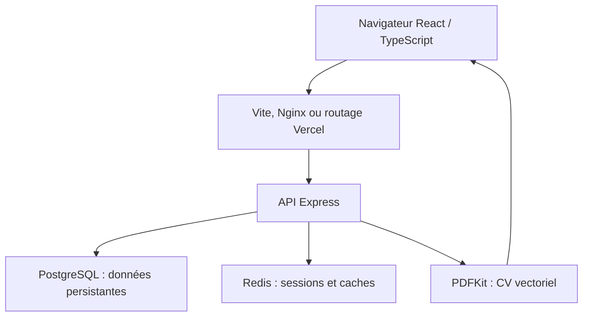
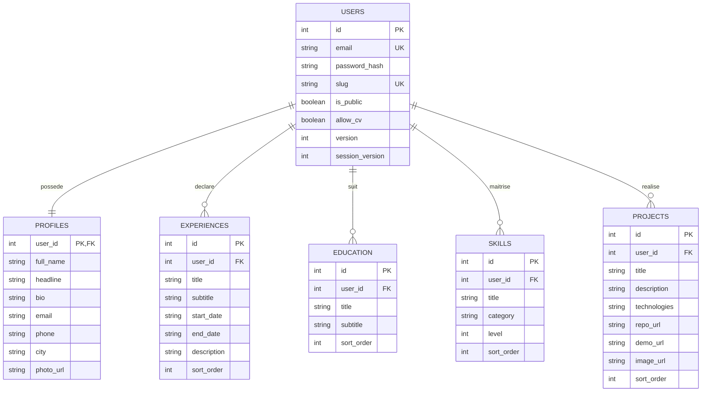

# Architecture et décisions techniques

## Flux applicatif

En local, quatre services Docker sont conservés : frontend, backend, postgres et redis. Le frontend Docker est compilé puis servi par Nginx. En développement, Vite offre le rechargement automatique. En production Vercel, le frontend est statique, Express est une fonction Node et les bases sont hébergées séparément.

## Modèle relationnel

Le SQL complet est la référence. Les quatre tables de contenu partagent un contrat commun, avec `title/subtitle` représentant poste/entreprise ou diplôme/établissement. Les colonnes inutilisées dans une section restent vides. Les dates sont des chaînes ISO validées par Zod : vide signifie « non renseigné » ou, pour la fin, « en cours ». Les identifiants des quatre tables utilisent la même séquence, ce qui permet une sélection unique d'éléments dans le CV. Les tables restent distinctes, avec clés étrangères et suppression en cascade. `technologies` est un tableau PostgreSQL `TEXT[]`.

Le courriel du compte est l'identifiant de connexion. Celui du profil est un contact public modifiable. Les mots de passe et les paramètres de session ne sortent jamais dans les réponses portfolio.

## Authentification et contrôle des accès

- bcrypt avec coût 12 ; mot de passe de 12 caractères minimum et 72 octets maximum.
- Jeton aléatoire de 256 bits stocké uniquement dans un cookie HttpOnly, SameSite=Lax, Secure en production.
- Redis conserve seulement un hash SHA-256 du jeton en clé, pendant 7 jours, avec l'identifiant et la version de session.
- L'API relit `session_version` en PostgreSQL. Un changement de mot de passe révoque toutes les anciennes sessions ; la suppression du compte les rend immédiatement inutilisables.
- Vérification stricte de l'en-tête Origin sur les écritures. Les appels API en ligne de commande doivent fournir cette origine eux aussi.
- Chaque accès aux éléments comprend le `user_id` de la session ; aucun identifiant utilisateur envoyé par le client n'est utilisé pour choisir le propriétaire.
- Les noms de tables viennent uniquement de la liste fixe des quatre sections ; les valeurs SQL sont paramétrées.
- URLs http(s) uniquement ; React échappe les textes ; aucune insertion HTML utilisateur.
- Limitation Redis atomique : connexion 15/15 min, inscription 8/h, modification de mot de passe et suppression 10/15 min, CV privé 40/5 min, public 30/5 min, par adresse vue par l'API.
- Nginx local groupe les utilisateurs derrière son adresse réseau pour cette limitation. En Vercel, l'API fait confiance à un proxy. Adapter la politique de proxy si l'architecture d'hébergement change.

Redis est obligatoire pour l'authentification. En cas de panne, les opérations privées échouent explicitement. La consultation publique hors CV peut continuer via PostgreSQL si seul le cache Redis est indisponible.

## Invalidation du cache

Chaque mutation augmente `users.version` dans la même transaction que les données. Les clés sont :

- `public:{id}:{version}` — TTL 300 secondes.
- `cv:{id}:{version}:{sha256(options)}` — TTL 3600 secondes.
- `session:{sha256(token)}` — TTL 7 jours.

L'invalidation est **logique et immédiate par version** : les anciennes clés ne sont plus consultées et expirent ensuite. Avant de servir une page ou un PDF public, l'API vérifie les autorisations en PostgreSQL. Une URL mise en cache ne contourne donc pas un passage en privé. Les réponses HTTP sont `no-store` pour éviter des copies publiques périmées dans le CDN. Les pages déjà téléchargées par un visiteur ne peuvent naturellement pas être révoquées.

Une lecture du portfolio utilise une transaction REPEATABLE READ pour obtenir profil, version et sections cohérents. La bibliothèque `pg` utilise un petit pool ; `attachDatabasePool` facilite sa gestion sur Vercel.

## Génération du CV

PDFKit a été choisi pour produire du texte vectoriel, sélectionnable et indexable, avec un coût inférieur au lancement d'un navigateur Chromium dans une fonction. Les polices DejaVu sont embarquées : accents indépendants des polices installées chez le lecteur. La licence est dans `assets/FONT-LICENSE.txt`.

Le modèle Classique est sobre en bleu ardoise ; le Moderne ajoute une bande latérale, un accent vert et une hiérarchie colorée. Le contenu vient toujours de PostgreSQL. L'aperçu et le téléchargement utilisent le même générateur et les mêmes options de cache. PDF.js affiche le PDF dans l'interface, y compris sur mobile, avec un chargement différé pour ne pas alourdir l'accueil. Les liens PDF sont cliquables. Les photos et images des projets sont destinées au portfolio ; le CV privilégie un document textuel lisible par les systèmes de candidature.

Le moteur essaie 10, 9, puis 8,5 points. Si le texte dépasse encore deux pages, l'API renvoie 422 et demande une sélection plus courte. Les titres et contenus saisis restent tels quels ; l'option anglais traduit les rubriques et « Aujourd'hui », pas les descriptions personnelles.

## Limites de cette version

Pas de récupération de mot de passe par courriel, de vérification du courriel, de téléversement de fichiers ni d'éditeur collaboratif. La dernière modification enregistrée l'emporte si deux onglets modifient le même contenu. Maximum 50 éléments par section et 3000 caractères par description. Pour une utilisation institutionnelle à grande échelle, ajouter récupération de compte, supervision, sauvegardes opérées par l'hébergeur et politique de conservation.
